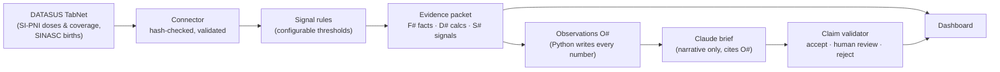
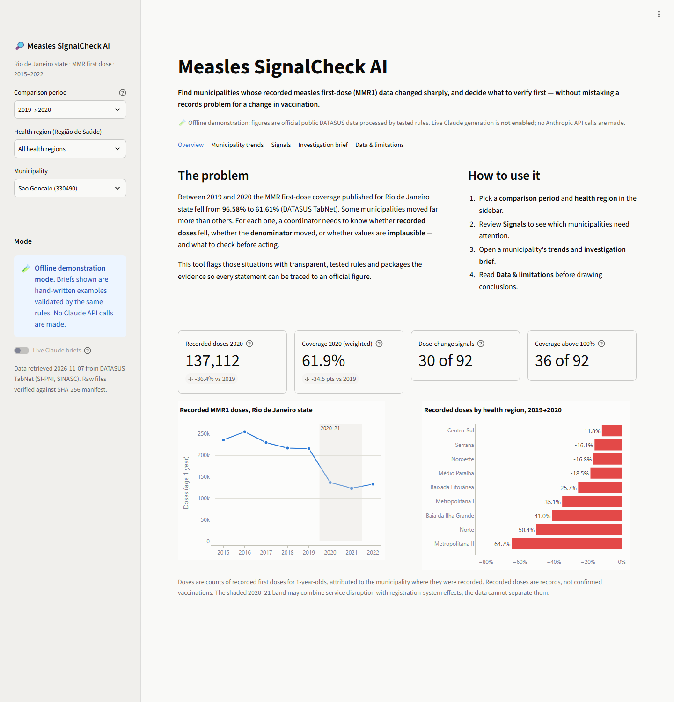
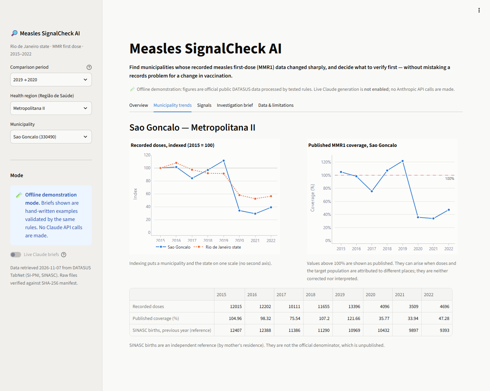
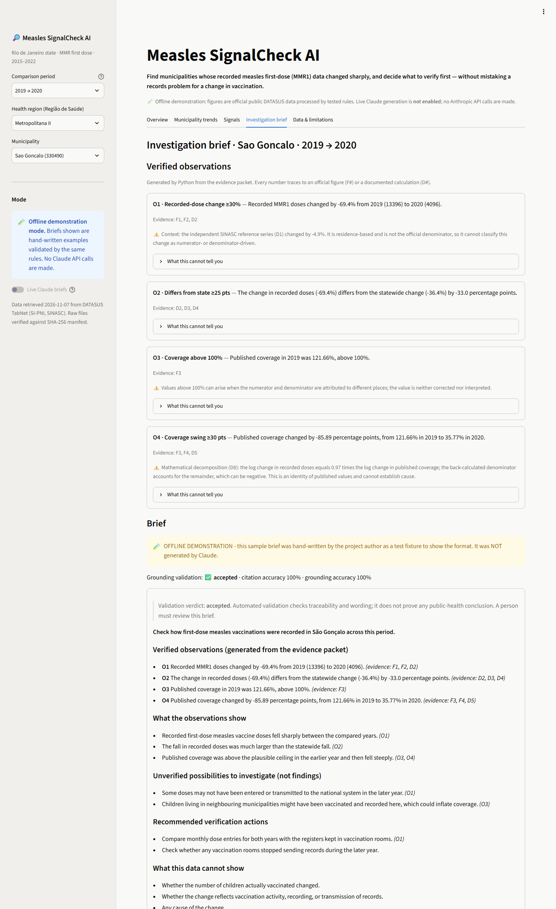

# Measles SignalCheck AI

[](https://github.com/bhavanasurapaneni-lab/measles-signalcheck-ai/actions/workflows/tests.yml)


> ### ▶️ [Try the Live Demo](https://measles-signalcheck-ai.streamlit.app/)
> **https://measles-signalcheck-ai.streamlit.app/** · **Offline demonstration**: verified public-health data
> (official DATASUS aggregates, processed by tested rules) with **no live Claude API generation**. The example
> brief is hand-written and labelled "NOT generated by Claude". No API key is used, no paid calls are made, and no
> login is needed. Hosted free on Streamlit Community Cloud: if the app is asleep, click to wake it (about a minute),
> and if asked, press "Download the public data from DATASUS TabNet".
> Jump straight to the São Gonçalo case:
> [investigation brief](https://measles-signalcheck-ai.streamlit.app/?period=2019&region=Metropolitana+II&unit=330490&tab=Investigation+brief).

**Evidence-grounded investigation support for immunization coordinators: real decline or records problem?**

In 2020, the measles first-dose (MMR1) coverage published for Rio de Janeiro state, Brazil, fell from **96.58% to
61.61%**. Some municipalities fell much further (São Gonçalo: 121.66% → 35.77%). A regional coordinator has to decide,
municipality by municipality, whether this reflects fewer children vaccinated, missing or late records, a shifting
denominator, or implausible data, and **what to check first**. Dashboards show the numbers. They don't separate
those possibilities, and generic AI summaries can state causes the data cannot support.

**Measles SignalCheck AI** turns official public data into **traceable evidence packets** with transparent,
tested rules. It then lets Claude write a short **investigation brief** under strict constraints: Claude may not
write a single number, every claim must cite verified evidence, and possible causes may only appear as hedged
hypotheses to check. Each brief is validated claim by claim before a person sees it.

> **What has actually been demonstrated** (details in [docs/EVALUATION_REPORT.md](docs/EVALUATION_REPORT.md))
> - ✅ Reproducible ingestion of official Brazilian Ministry of Health data (SI-PNI and SINASC via DATASUS TabNet) with SHA-256 provenance
> - ✅ Deterministic signal rules and schema-validated evidence packets: **644 municipality-year packets validated**
> - ✅ Claim-level grounding validator: **20/20 expected verdicts** on labelled synthetic drafts (offline)
> - ✅ Streamlit dashboard for non-technical coordinators, runnable locally and as a [public offline demo](https://measles-signalcheck-ai.streamlit.app/); **135 automated tests pass**
> - ⏸️ **Claude API integration implemented but NOT validated with a live API call** (deferred; $0 spent)
> - ❌ Not demonstrated: use by real health teams, health impact, production reliability, clinical validation

**Data:** official, public, aggregate data from Brazil's Ministry of Health (DATASUS TabNet: SI-PNI immunization
doses and coverage; SINASC live births; health-region mapping). 92 municipalities, 2015–2022. No personal records.

**Why Claude, and why only here.** Counting, comparing and flagging are deterministic, so Python does them and
they are tested. What coordinators lack is time to turn a table of flags into a clear, cautious note: what the
records show, what they cannot show, and which checks to run first, in language a programme lead can act on.
That is the part Claude writes. Its output is constrained to cite verified observations and is checked before
anyone sees it.

*Independent project by Bhavana Surapaneni. Not an official tool of WHO, Anthropic or the Brazilian Ministry of Health.*

---

## Five-minute tour
1. **Read this page** (2 min): the problem, the approach, what's demonstrated.
2. **Look at one evidence packet** (1 min): [docs/examples/evidence_packet_330490_2019_2020.json](docs/examples/evidence_packet_330490_2019_2020.json). Every value has an ID (F#, D#), a source file, and a method.
3. **Skim the architecture** (1 min): [docs/ARCHITECTURE.md](docs/ARCHITECTURE.md), especially the diagram and "Demonstrated vs not demonstrated".
4. **See how AI output is checked** (1 min): the adversarial cases table in [docs/EVALUATION_REPORT.md](docs/EVALUATION_REPORT.md#adversarial-and-failure-cases).

## How it works

- **Doses, denominators and published coverage are kept separate.** The official denominator is unpublished, so the tool never presents a recalculated percentage as official.
- **Signals are review triggers, not conclusions.** They cover a recorded-dose change of 30% or more, a coverage swing of 30 points or more, coverage above 100%, a 25-point or larger difference from the weighted state benchmark, and small numbers. Missing data yields `insufficient_evidence`, never zero.
- **Comparisons stop at the 2023 SI-PNI/RNDS reporting-system transition.** Analyses across it are refused.
- **Claude is constrained by design:** one structured-output call (`messages.parse`), a cached system prompt, explicit effort setting, no refusal fallback (for reproducible evaluation), and a validator that rejects numbers, wrong places, wrong indicators, wrong directions, causal claims and prompt-injection echoes.

## Demonstration walkthrough
A timed five-minute script with what to say at each step is in [docs/DEMO_WALKTHROUGH.md](docs/DEMO_WALKTHROUGH.md).

1. Open the [live demo](https://measles-signalcheck-ai.streamlit.app/), or install and launch locally (below). Either way the dashboard runs in **offline demonstration mode**.
2. Sidebar: period **2019 → 2020**, region **Metropolitana II**, municipality **São Gonçalo**.
3. **Overview**: statewide recorded doses fell 36.4%; Metropolitana II fell 64.7%.
4. **Signals**: 30 of 92 municipalities crossed the recorded-dose threshold; filter and export the list.
5. **Municipality trends**: São Gonçalo's doses (indexed to 2015) against the state; published coverage above 100% in 2019.
6. **Investigation brief**: four verified observations with evidence IDs, what the data cannot show, and a **labelled demonstration brief** (hand-written fixture, *not* Claude output) that passed the validator.
7. **Data & limitations**: sources, the 2023 break, and permitted and prohibited interpretations.

### Screenshots (real captures of the running app, offline demonstration mode)

**Overview: statewide and regional change in recorded MMR1 doses, 2019 → 2020**


**São Gonçalo trends: recorded doses indexed to 2015 vs the state; published coverage above 100% in 2019**


**Investigation brief: verified observations with evidence IDs and a clearly labelled offline demonstration brief (not Claude output)**


The Signals view and capture details are in [docs/screenshots/](docs/screenshots/README.md).

## Install and run
You need **Python 3.11+** (3.12 is tested). **No API key is needed**, and nothing in setup calls a paid service.

**Windows (PowerShell)**
```powershell
python -m venv .venv
.\.venv\Scripts\python.exe -m pip install -r requirements.txt
.\.venv\Scripts\python.exe scripts\fetch_tabnet.py            # public DATASUS data (~23 KB)
.\.venv\Scripts\python.exe scripts\fetch_health_regions.py    # health-region list (2.1 MB form page)
.\.venv\Scripts\python.exe -m streamlit run app\streamlit_app.py --server.address localhost
.\.venv\Scripts\python.exe -m pytest -q                       # 135 tests
.\.venv\Scripts\python.exe -m evals.run_offline               # validator evaluation, offline
```

**macOS / Linux**
```bash
python3 -m venv .venv && source .venv/bin/activate
pip install -r requirements.txt
python scripts/fetch_tabnet.py && python scripts/fetch_health_regions.py
streamlit run app/streamlit_app.py --server.address localhost
python -m pytest -q && python -m evals.run_offline
```
Open http://localhost:8501 (stop with Ctrl+C). If you skip the fetch scripts, the dashboard offers a
**"Download the public data from DATASUS TabNet"** button instead. Deep links work, e.g.
`/?period=2019&unit=330490&tab=Investigation+brief`.
- Raw files are saved **unchanged**, with a manifest (URLs, query selections, retrieval time, SHA-256). The connector refuses altered files. The fetch scripts contact only `tabnet.datasus.gov.br`, reject non-table responses, and won't replace an existing snapshot unless you pass `--force`.
- The reference snapshot was retrieved on 7 Nov 2026. SINASC can be revised, so a fresh download may change hashes. Reference-value tests then show exactly what changed.
- Tests that need raw data are skipped (not failed) if `data/raw/` is empty.
- **Optional live Claude briefs** need your own key in a git-ignored `.env` (copy `.env.example`) **and** `SIGNALCHECK_ENABLE_LIVE=1`. The live evaluation harness (`evals/run_live.py`) refuses to run without an approved spending cap.

## Evaluation results (summary)
| Area | Result |
|---|---|
| Automated tests (local, with data) | 135 passed (connector, signals, packets, briefs, dashboard, failure modes) |
| Continuous integration ([workflow](.github/workflows/tests.yml)) | Offline, no key, Ubuntu + Windows, Python 3.12. The data isn't in the repo, so CI runs the 32 data-independent tests and reports 103 as skipped, with reasons |
| Agreement with published figures | State coverage within 0.3 pts of TabNet totals; national dose filter reproduces the WHO-reported target within 0.1% |
| Evidence packets | 644/644 statewide packets pass schema, reference, number-grounding and language checks |
| Brief validator (offline) | 20/20 expected verdicts across 18 failure modes: wrong number, place, year, indicator or direction; causal or uptake claims; injection; uncovered evidence |
| Live Claude evaluation | **Deferred: not run, no results claimed** |

## Responsible AI and limitations
- **Recorded doses are records, not confirmed vaccinations.** The data shows *what* changed, never *why*.
- **Human oversight:** every brief is labelled accepted, needs human review, or rejected, and states that validation doesn't prove any public-health conclusion. Rejected briefs are never automatically repaired.
- **Privacy:** only public, aggregate municipality-year data. Only validated packets would be sent to the API. Keys stay in a git-ignored `.env` and are never logged.
- **Limits:** one state, one indicator, 2015–2022. Rule-based validation can't guarantee semantic faithfulness. There's no ground truth for real data-quality problems. Not tested with real coordinators. Light theme only. The [public demo](https://measles-signalcheck-ai.streamlit.app/) runs on a free tier: it can sleep when idle, and it depends on DATASUS TabNet being reachable to re-download data after a restart.
- Details: [docs/SECURITY_AND_GOVERNANCE.md](docs/SECURITY_AND_GOVERNANCE.md) · [DATA_CARD.md](DATA_CARD.md)

## Documentation
| Document | Purpose |
|---|---|
| [docs/ARCHITECTURE.md](docs/ARCHITECTURE.md) | Components, data flow, decisions, deployment options |
| [docs/EVALUATION_REPORT.md](docs/EVALUATION_REPORT.md) | Tests, grounding checks, adversarial cases, unresolved risks |
| [docs/SECURITY_AND_GOVERNANCE.md](docs/SECURITY_AND_GOVERNANCE.md) | Data classification, injection, keys, oversight (implemented vs proposed) |
| [docs/REUSE_GUIDE.md](docs/REUSE_GUIDE.md) | Adapter spec, packet schema reference, prompt template, evaluation method |
| [docs/workshop/](docs/workshop/FACILITATOR_GUIDE.md) | Simulated 90-minute tabletop exercise (facilitator guide + participant sheet) |
| [docs/PILOT_PLAN.md](docs/PILOT_PLAN.md) | Proposed 12-week pilot with a go/no-go framework (no partnership exists) |
| [docs/DEMO_WALKTHROUGH.md](docs/DEMO_WALKTHROUGH.md) | Timed five-minute demo script (São Gonçalo 2019 → 2020) |
| [docs/DEPLOYMENT_STREAMLIT_CLOUD.md](docs/DEPLOYMENT_STREAMLIT_CLOUD.md) | Free public offline demo on Streamlit Community Cloud ([live](https://measles-signalcheck-ai.streamlit.app/)): safeguards, steps, risks |
| [DATA_CARD.md](DATA_CARD.md) · [DATA_SOURCES.md](DATA_SOURCES.md) | Dataset documentation and source research |
| [PROJECT_DECISIONS.md](PROJECT_DECISIONS.md) · [PROJECT_PLAN.md](PROJECT_PLAN.md) | Decision log (D-001…) and milestones |

## Repository map
```
app/streamlit_app.py            dashboard (offline demonstration mode)
src/signalcheck/                connectors/, schema, tabnet, coverage, signals, evidence,
                                briefing, brief_validator, brief_client, demo_briefs, dashboard_data
scripts/                        fetch_tabnet, fetch_health_regions, run_signals, check_api_key
config/ schemas/ prompts/       thresholds, packet JSON Schema, versioned prompt + template
evals/                          cases, fake client, offline and (gated) live harnesses
tests/                          135 tests (.github/workflows/tests.yml runs them offline in CI)
docs/                           architecture, evaluation, security, reuse, workshop, pilot, examples
```

## Licence
The original code and documentation in this repository are released under the [MIT License](LICENSE).
The licence does **not** cover third-party data: the Brazilian Ministry of Health (DATASUS TabNet) data are
not redistributed here (they are downloaded by the fetch scripts), and the aggregate figures quoted in the docs
and in `docs/examples/` are attributed to their official source.

## Data source and disclaimer
Ministério da Saúde (Brazil), DATASUS TabNet: SI-PNI *Imunizações – Cobertura* and *Doses Aplicadas* (1994–2022);
SINASC *Nascidos Vivos – Rio de Janeiro*; CIR health-region mapping. Accessed 7 Nov 2026. This is an independent
research project. Its outputs must not replace official programme review, and changes in recorded doses are not
proof of changes in vaccination uptake.
