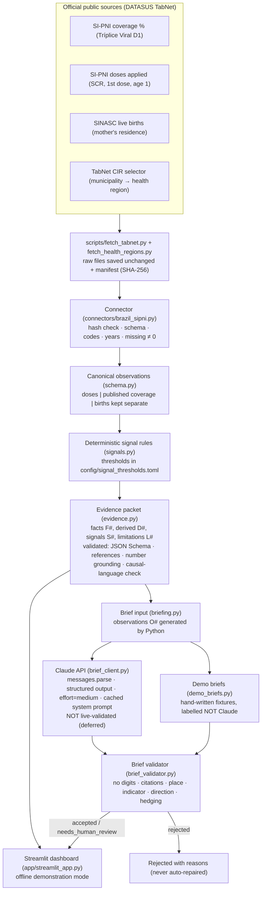

# Architecture — Measles SignalCheck AI

*Reflects the code at Milestone 7 (Nov 2026). Section 7 marks every capability as **demonstrated** or **not demonstrated**.*

## 1. Design principle

> **Python computes and verifies every number. Claude may only write narrative around verified observations, and every claim it makes is checked before anyone sees it.**

The tool is meant to help a regional immunization coordinator decide *what to check*. It is not designed to tell them *why* something happened. The architecture keeps three kinds of statement apart:

| Kind | Produced by | Example |
|---|---|---|
| **Observed fact** | Connector (official data) | "Recorded doses in 2020: 4,096" |
| **Deterministic signal** | Rules (`signals.py`) | "Recorded doses changed by −69.4%" (crossed the 30% review threshold) |
| **Narrative / suggested checks** | Claude, or a labelled hand-written demo | "Compare monthly entries with vaccination-room registers" |

## 2. System diagram

## 3. Components

| Layer | Files | Responsibility | Key guarantees (tested) |
|---|---|---|---|
| Acquisition | `scripts/fetch_tabnet.py`, `scripts/fetch_health_regions.py` | Re-run the documented TabNet queries and save TabNet's own exports unchanged, with a manifest | Fails loudly if a form option disappears. Raw data is git-ignored |
| Connector | `src/signalcheck/connectors/{base,brazil_sipni}.py`, `tabnet.py`, `schema.py` | Parse into one canonical long table | Refuses altered or missing files (hash), bad IBGE codes and unexpected years. Missing cells become NaN plus a report, never 0 |
| Safeguarded calculations | `coverage.py` | Sensitivity coverage and observed change | Only for compatible pairs with a valid denominator. Refuses comparisons across the **2023 system break** |
| Signals | `signals.py`, `config/signal_thresholds.toml` | R1–R5 plus `insufficient_evidence` | Consecutive years only. Weighted state benchmark. Back-calculated denominators labelled. No numerator- or denominator-driven classification |
| Evidence packet | `evidence.py`, `jsonschema_lite.py`, `schemas/evidence_packet.schema.json` | Traceable, validated JSON | Every number in signal text is grounded. No causal or uptake language. No free-text fields (limits injection) |
| Brief contract | `briefing.py`, `prompts/brief_v1.md` | Observations O# (Python), `BriefDraft` output format | Claude writes no numbers. Three claim kinds |
| Claude client | `brief_client.py` | One `messages.parse` call per packet | Pre-send packet validation. Each failure has an explicit status. No refusal fallback. Offline switch |
| Brief validator | `brief_validator.py` | Claim-level checks | Rejects numbers, wrong place, wrong indicator, wrong direction, minimising, unhedged causes and injection echoes. Interpretive verbs go to human review |
| Interface | `app/streamlit_app.py`, `dashboard_data.py`, `demo_briefs.py` | Coordinator workflow | Weighted aggregates. Offline banner. Live switch disabled. Safe error states |
| Evaluation | `evals/`, `tests/` | Offline evaluation, gated live harness | 135 tests; offline CI (GitHub Actions). Live runs need an approved spending cap |

## 4. Data flow for one question
*"Why did São Gonçalo's MMR1 coverage collapse in 2020?"*
1. The connector loads doses (13,396 → 4,096), published coverage (121.66% → 35.77%) and SINASC births (10,969 → 10,432) for IBGE 330490.
2. The rules raise S1 recorded-dose change (−69.4%), S2 state divergence (−33.0 pts vs −36.4% statewide), S3 coverage above 100% (2019) and S4 coverage swing (−85.89 pts).
3. The packet adds D# calculations, including a **labelled arithmetic decomposition** (share 0.97). It also states what cannot be concluded and 6 limitations.
4. Python turns S1–S4 into observations O1–O4. A brief (live Claude, or the labelled demo fixture) may only cite O1–O4 in words, without numbers.
5. The validator accepts it. The dashboard shows the observations, the brief and what the data cannot show.
6. **The tool never answers "why"**: it says recorded doses fell while births changed about 5%, and proposes checks.

## 5. Key architectural decisions
Full log in `PROJECT_DECISIONS.md`.

| Decision | Why | Trade-off |
|---|---|---|
| Python writes every number (D-022) | Plain text checks can't catch "right number, wrong place or year". Banning digits in model text removes that whole class of error | Briefs are less fluent, and Claude must refer to O# instead of quoting values |
| Single API call, no agent (D-020) | The task is fully specified, and the cost of an error is high | No autonomous exploration (not needed) |
| Structured output via `messages.parse` (D-021) | Schema-valid drafts, and the effort setting sits alongside the format | Validated against SDK 2.6.0 offline only |
| No refusal fallback (D-020) | Reproducible evaluation | A refusal yields no brief |
| Doses first, coverage as published (D-010) | The official denominator is unpublished | Coordinators think in coverage %, so the interface has to explain this |
| Comparisons only within 2015–2022 (D-011) | 2023 SI-PNI/RNDS transition | No recent years |
| Hand-written JSON Schema validator (D-019) | No new dependency | Less conventional than `jsonschema` |
| Local-first deployment (D-008), plus a public offline demo (D-034) | Public aggregate data, no hosting secrets | The public demo shows offline examples only, no live Claude briefs |

## 6. Deployment options
**Implemented: A (local) and D (public offline demo at https://measles-signalcheck-ai.streamlit.app/).** The others are options only.

| Option | Fit | Requirements before use |
|---|---|---|
| **A. Local workstation** (current) | Single analyst, offline demo | Python 3.11+. Data: a 23 KB sample plus a 2.1 MB TabNet form page (region mapping) |
| **B. Offline HTML export of briefs** | Low-connectivity field teams (the pattern the IRC case study describes) | Build an export of rendered briefs. No API needed at the point of use |
| **C. Internal server** (ministry or NGO network) | A team of coordinators | Authentication, HTTPS, audit logging, key held server-side, an approved data-use policy (`SECURITY_AND_GOVERNANCE.md` §9) |
| **D. Hosted demo** (Streamlit Community Cloud, **live**) | Public visitors and evaluators | Demo mode only. No key needed or stored. Data downloaded from DATASUS TabNet on first visit after a restart |
| **E. DHIS2-adjacent** | Ministries running DHIS2 | A new connector for a DHIS2 analytics export (`REUSE_GUIDE.md`). Aggregate data only |

## 7. Demonstrated vs not demonstrated
| Capability | Status |
|---|---|
| Reproducible ingestion of official public data with provenance | **Demonstrated** (tests, manifest hashes) |
| Deterministic signals and validated evidence packets | **Demonstrated** (135 tests, 644 statewide packets validated in Milestone 4) |
| Claim-level grounding validator | **Demonstrated offline** on 20 labelled synthetic drafts (20/20 expected verdicts) |
| Claude API integration | **Implemented; NOT validated with a live API call** (deferred, D-025) |
| Dashboard | **Demonstrated** locally (headless app tests and a manual browser walkthrough) and as a public offline demo |
| Use by real coordinators, health impact, production reliability | **Not demonstrated** |

## 8. Known limitations
- Recorded doses are records, not confirmed vaccinations. The official denominator is unpublished.
- One state (Rio de Janeiro), one indicator (MMR1), and the years 2015–2022.
- Rule-based validation can't guarantee semantic faithfulness: it can miss a subtly misleading sentence or wrongly reject a valid one.
- No authentication, multi-user support or audit trail in the current interface.
